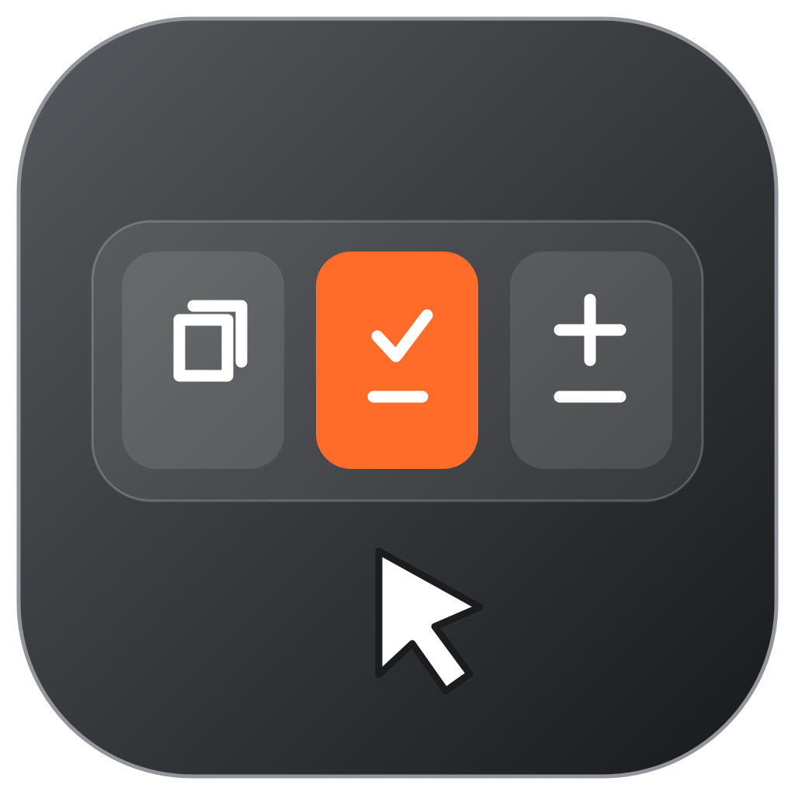
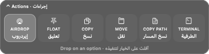
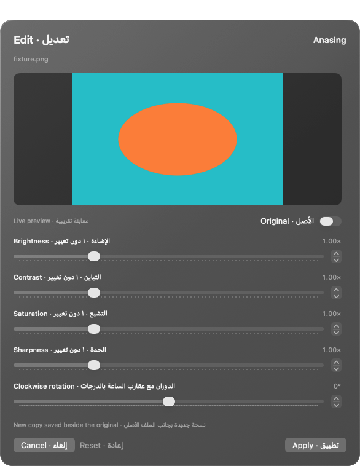
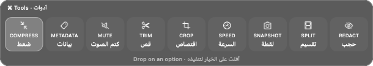
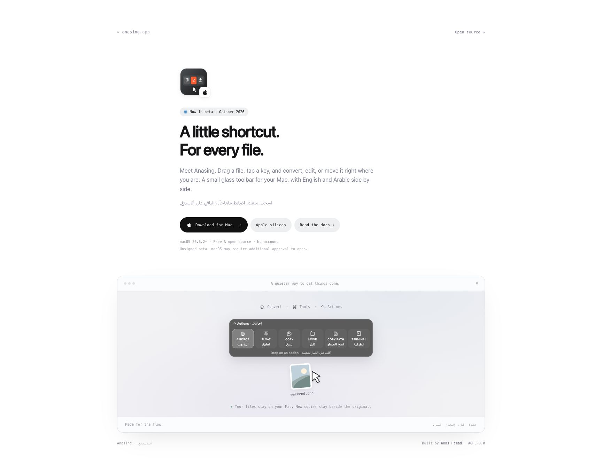

<p align="center"></p>
<h1 align="center">Anasing · أناسينغ</h1>
<p align="center">Drag a file. Tap a key. Drop onto an action.<br>اسحب ملفاً، اضغط مفتاحاً، وأفلت على الإجراء المطلوب.</p>

Anasing is a small macOS background utility for file conversions and quick actions. A **compact horizontal glass action bar appears above the file you are dragging**. There is no main window or Dock icon. Labels show English and Arabic together, with audible hover and selection feedback.



## Download and install · التنزيل والتثبيت

**Current build: 0.6.2-beta.1 — Apple silicon, macOS 26.6.2 or later.** Intel Macs and earlier macOS versions are not supported by this bundled beta.

Download `Anasing-0.6.2-beta.1-arm64-unsigned.dmg` from [GitHub Releases](https://github.com/anashamad9/amassing/releases), drag **Anasing.app** into **Applications**, then open it once. The app stays in the menu bar. Its conversion engines are bundled: recipients do not need Homebrew, Xcode, Python, or LibreOffice installed separately.

> **Unsigned beta:** the prepared artifact is ad-hoc signed, not Developer ID-signed or Apple-notarized. macOS may block an unsigned download. Do not disable macOS security features. A publisher should complete the signing and notarization procedure in [RELEASING.md](RELEASING.md) before calling it a normal public installer.

**بالعربية:** تتطلب النسخة التجريبية جهاز Apple silicon وإصدار macOS 26.6.2 أو أحدث. اسحب التطبيق إلى Applications وافتحه مرة واحدة. تتضمن النسخة أدوات التحويل، ولا تحتاج إلى تثبيت برامج إضافية. النسخة الحالية غير موثقة من Apple وقد يمنع النظام تشغيلها.

The release should include the DMG, `SHA256SUMS.txt`, the Anasing source archive, and the third-party source archive. Large binaries belong in **GitHub Release assets**, not in Git commits.

## Use · الاستخدام

Start dragging a file or folder, then tap one of these keys:

| Key | Action bar |
| --- | --- |
| **Shift ⇧** | Convert · تحويل |
| **Command ⌘** | File tools · أدوات |
| **Control ⌃** | File actions · إجراءات الملفات |

Release the key and continue dragging. The bar stays open. Tap another modifier to switch modes, then drop on an option. Dropping outside the options cancels. The bar is positioned above the drag point and falls below it if the screen edge leaves insufficient space.

اسحب الملف ثم اضغط المفتاح المطلوب. يبقى الشريط ظاهراً بعد رفع إصبعك عن المفتاح. اسحب إلى الخيار وأفلت للتنفيذ، أو أفلت خارج الخيارات للإلغاء.

Edited and converted copies are saved **beside each source file** with a new name. Existing files are never overwritten. Combining files, such as merging PDFs, saves beside the first source. A compact status card shows progress, errors, and result previews, including the pages of PDF-to-image conversions. You can open the result or reveal it in Finder. **Last result · آخر نتيجة** reopens the latest card.

Anasing registers to launch automatically when you log in to your Mac. Use **Launch at login · التشغيل عند تسجيل الدخول** in the menu to switch this off. If macOS requires approval, choose the menu’s settings link and allow Anasing in **System Settings → General → Login Items & Extensions**. Your later opt-out is respected.

The menu bar also provides pause, cancellation, previews, sound effects on/off, and quit. Sound levels are intentionally stronger in this version; they still respect the Mac's output volume and mute setting.

## Visual editors · أدوات مرئية

Photo adjustments use sliders, a live preview, an Original comparison toggle, and Reset. The preview approximates the full-resolution export. Crop, redaction, and annotation use a rectangle you draw directly over the image. Colors use a native color picker and swatches. Background padding, corner radius, font size, compression quality, and collage spacing use sliders; finite settings such as bitrate, output width, speed, and audio channels use selectors.

Media editors offer playback, a scrubber, and draggable start/end handles with a visible duration. Snapshot times are added at the current playback position and can be removed individually. PDF organization shows page thumbnails: click to include/exclude, then use the arrows to change output order and the rotation selector to rotate. Text entry is reserved for captions and metadata. Native media previews depend on formats supported by macOS; convert unsupported inputs to MP4 before visual trimming or cropping.

أدوات الصور تستخدم منزلقات ومعاينة مباشرة، والألوان لها منتقي وعينات جاهزة. اسحب لتحديد الاقتصاص، وحدد وقت البداية والنهاية من الشريط الزمني، واختر صفحات PDF ورتبها من الصور المصغرة. الكتابة مطلوبة فقط للنصوص والبيانات الوصفية.



## File actions

**AirDrop / إيردروب · Float / تعليق · Copy / نسخ · Move / نقل · Copy Path / نسخ المسار · Terminal / الطرفية**

These actions work with files, folders, and mixed selections. AirDrop opens Apple's recipient picker. Float opens an on-demand tray you can drag files out of. Move asks for a destination and checks for conflicts before changing originals. Terminal opens at the folder or the first file's parent folder.

## Conversions and tools

| File type | Available workflows |
| --- | --- |
| Images | PNG, JPG, WebP, HEIC, TIFF, AVIF, BMP, PDF; compress/resize, metadata, crop, color adjustments, rotation, annotation, backgrounds, region redaction, collage, combined PDF |
| Video | MP4, MOV, MKV, WebM, AVI, WMV, GIF, MP3 export; compress, metadata, mute, trim, crop, speed, snapshots, split, region redaction, join |
| Audio | MP3, M4A, WAV, FLAC, OGG, Opus, AIFF, WMA; compress, metadata, normalize, waveform video, trim, mono/stereo, bleep a range |
| PDF | DOCX, PPTX, XLSX, JPG/PNG pages, EPUB, TXT, Markdown; compress, metadata, split, reorder, rotate, merge |
| Documents | DOCX, PDF, TXT, Markdown, HTML, EPUB, JPG/PNG; rich-text input through the document engine |
| Slides | PPT/PPTX input to PDF, JPG, PNG |
| Spreadsheets | XLS/XLSX, ODS, CSV, TSV input; XLSX, ODS, CSV, TSV, PDF output |
| EPUB | PDF, DOCX, TXT, Markdown, HTML |
| Subtitles | SRT, VTT, TXT |
| Archives | ZIP, TAR, GZIP conversion and extraction; RAR input |

SVG is an image input and is rasterized on export. Single-file bars omit the existing format. GIF input has video conversions and metadata removal. Homogeneous selections support batch conversions; mixed selections use the Control action bar.



## Limits of this beta

- Apple Pages export is unavailable; choose DOCX instead. Pages input depends on LibreOffice's importer.
- PDF to DOCX exports text. PDF to PPTX preserves pages as slide images. XLSX uses detected tables or falls back to text lines; perfect editable layout reconstruction is not promised.
- Scanned PDF text uses bundled English OCR. Recognition depends on the scan.
- CSV/TSV export the first worksheet. Document conversion can alter complex layout.
- Redaction covers a manually selected region. Automatic face/text detection and tracking are not implemented.
- File drags must provide standard macOS file URLs. Browser file promises, undownloaded cloud placeholders, encrypted PDFs, and password-protected archives are unsupported.
- Launch at login is enabled on first normal launch. Turn it off from the menu or macOS Login Items. macOS may require approval in System Settings.
- Automated tests and a bundled dependency audit pass on the development Mac. Independent testing on a clean Mac is still required before a production release.

## Folder access · صلاحيات المجلدات

macOS controls access to Downloads, Desktop, Documents, and other protected locations. If access is blocked, choose the source folder in Anasing’s permission picker once. The grant is saved and restored for every action; you can also use **Allow folder access… · السماح بالوصول للمجلد** in the menu to select several folders in advance. Later permission failures offer **Allow & retry** with the original editor settings preserved.

The native app reads selected files and saves results. Conversion helpers receive private temporary copies rather than original protected paths, so Python, FFmpeg, and Office do not need separate access to your source folders. Temporary copies are removed when the operation finishes. Outputs still appear beside the original; existing files remain untouched. macOS can revoke permissions or require a new grant, and Anasing cannot override that decision. Grant folders you use rather than disabling system security.

إذا منع النظام الوصول، اختر مجلد الملف مرة واحدة؛ تحفظ الصلاحية لجميع الإجراءات وبعد إعادة تشغيل التطبيق. تستخدم أدوات التحويل نسخاً مؤقتة، وتبقى النتائج بجانب ملفاتك الأصلية.

## Privacy

Files are processed locally. No accounts, telemetry, cloud conversion, or clipboard history. Clipboard access happens only for explicit Copy actions. The current file drag pasteboard and modifier/mouse state are used to display the bar. Accessibility and Input Monitoring permissions are not requested. AirDrop transmits only through the recipient flow you choose.

## Landing page

The one-section Next.js page lives in [`landing/`](landing/README.md). Run `npm ci && npm run dev` in that folder, or set **landing** as the project root on Vercel. `npm run build` exports a static site in `landing/out/`. The download button points to this repository’s beta release. No hosting credentials, accounts, or analytics are required.



## Build from source

Requires an Apple silicon development Mac, Xcode with Swift 6, Python 3.9+, and Homebrew in `/opt/homebrew`.

```sh
./scripts/setup.sh
./scripts/build.sh
open dist/Anasing.app
```

For the self-contained app and DMG:

```sh
./scripts/fetch_runtime.sh
./scripts/build.sh
python3 scripts/bundle_portable.py
./scripts/test_portable.sh
python3 scripts/collect_sources.py
python3 scripts/create_source_archive.py
./scripts/package_dmg.sh
```

See [RELEASING.md](RELEASING.md) for the exact release assets, GitHub upload steps, and Developer ID/notarization workflow. The `Build beta` GitHub Actions workflow generates unsigned release artifacts on an Apple silicon macOS runner.

## Validation

```sh
# Native bar geometry, key latching, drag routing, bilingual labels, sounds, file moves:
dist/portable/Anasing.app/Contents/MacOS/Anasing --smoke-test

dist/portable/Anasing.app/Contents/MacOS/Anasing --editor-test

dist/portable/Anasing.app/Contents/MacOS/Anasing --file-access-test

# Native-to-bundled-engine conversion and PDF image-preview checks:
dist/portable/Anasing.app/Contents/MacOS/Anasing --pipeline-test
dist/portable/Anasing.app/Contents/MacOS/Anasing --pdf-feedback-test

# All real-file integration tests, using bundled engines and a restricted PATH:
./scripts/test_portable.sh
```

The 17 integration test groups cover all ten file categories, image pixels and dimensions, media streams and timing, PDF pages and rotation, workbook cells, OCR, subtitle timing, archive paths, cancellation, same-folder outputs, collision handling, and original-file checksums.

## License and source

Anasing is **AGPL-3.0-only**. See [LICENSE](LICENSE). Third-party components retain their own licenses; see [THIRD_PARTY_NOTICES.md](THIRD_PARTY_NOTICES.md) and the packaged license files. Publish corresponding source materials alongside binary releases. This project is independently implemented and is not affiliated with Tangerine or ShelfyDock.
